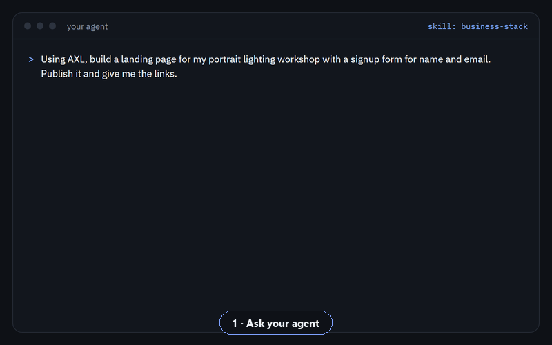
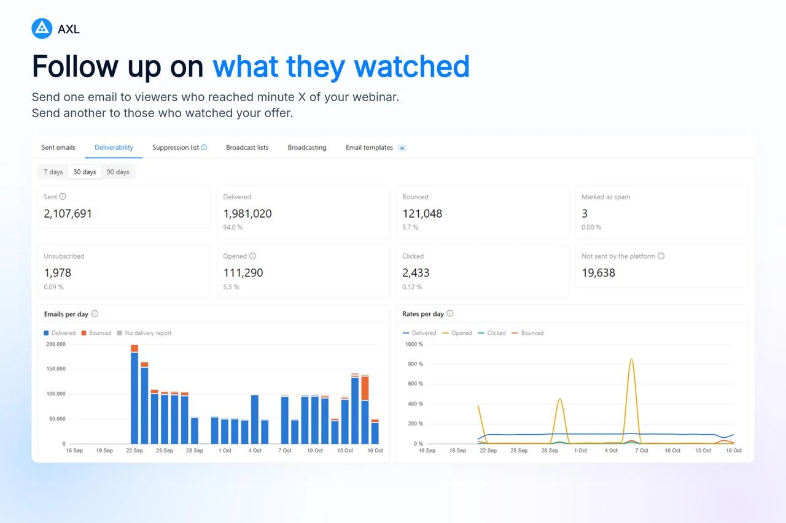
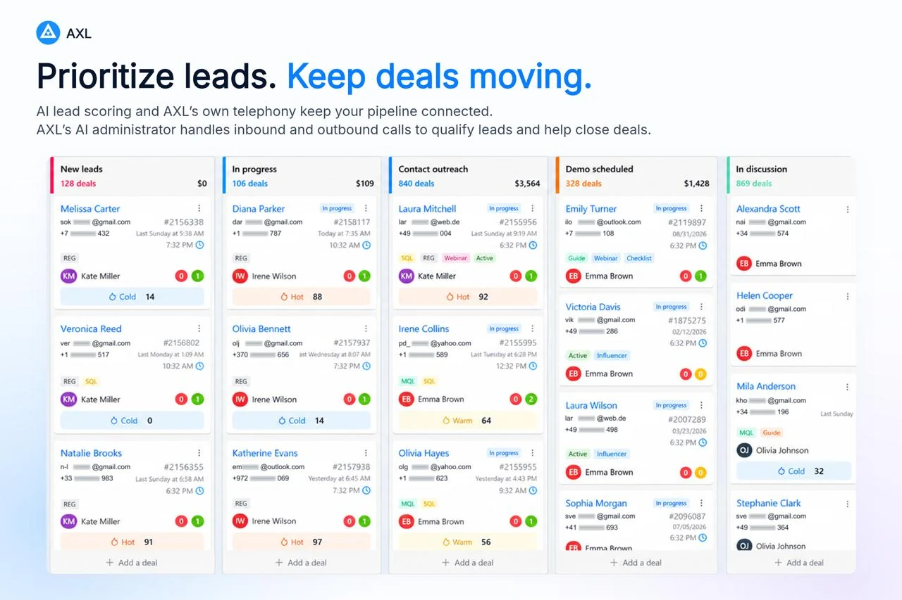
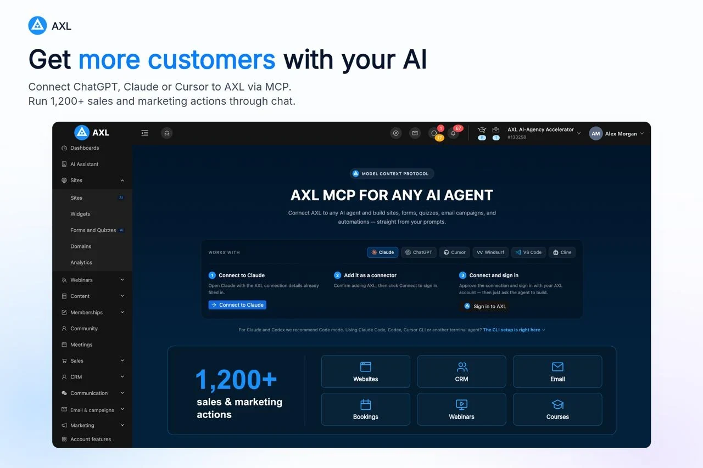
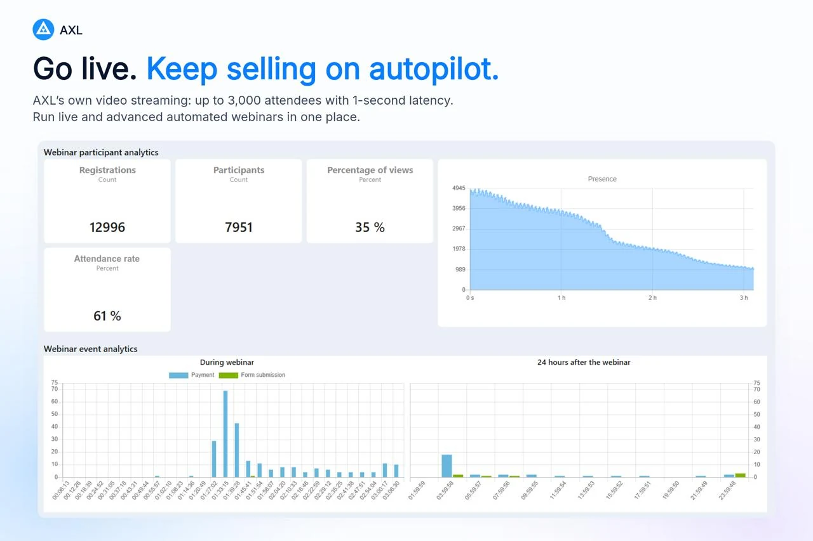
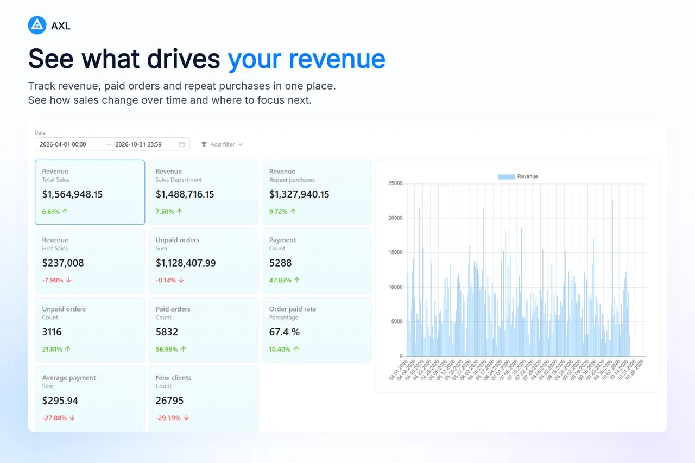

<p align="center">
  
</p>

<h1 align="center">AXL Business Stack</h1>

<p align="center"><b>Get more customers with the AI you already use.</b></p>

<p align="center">Give your AI agent one connected place to build landing pages, capture leads, book demos and follow up.<br>Every interaction adds to the same customer history.</p>

<p align="center">Open-source agent skill. Powered by <a href="https://axl.tech">AXL</a>.</p>

<p align="center">
  <a href="https://axl.tech"></a>
  <a href="https://agentskills.io"></a>
  <a href="skills/business-stack/references/connect.md"></a>
  <a href="LICENSE"></a>
</p>

**Free to start, and free to build.** New accounts start on AXL's Free plan: no card and no time limit, with usage limits and the AXL badge. Your agent does the building with its own model, so a landing page, a booking link and a CRM cost you nothing in AXL. Upgrade only when you outgrow the limits.

Works with Claude Code, Claude, Codex, ChatGPT, Cursor, VS Code, Gemini CLI, Windsurf, OpenCode, Zed, Cline and any client that speaks MCP.

<p align="center">
  <a href="#see-it-work">See it work</a> ·
  <a href="#install">Install</a> ·
  <a href="#your-first-run">First run</a> ·
  <a href="#one-customer-history">One customer history</a> ·
  <a href="#what-else-your-agent-can-launch">What it launches</a> ·
  <a href="#faq">FAQ</a>
</p>

## See it work

<p align="center">
  
</p>

<p align="center"><sub>A real MCP run on an AXL demo account, about 40 seconds: one request, a published page, a test signup, the lead in the CRM.</sub></p>

## Install

```bash
npx skills add axlhq/business-stack
```

The [`skills`](https://github.com/vercel-labs/skills) CLI asks which agents to install into. Add `-g` to install for your user instead of the current project, or `-a claude-code codex cursor` to pick agents up front. The first time a task calls for AXL, the skill walks your agent through connecting the MCP server.

<details>
<summary><b>Claude Code plugin</b> (skill and MCP server in one step)</summary>

```text
/plugin marketplace add axlhq/business-stack
/plugin install business-stack@axlhq
```

Restart Claude Code, run `/mcp`, choose `plugin:business-stack:axl` and sign in. Update later with `/plugin marketplace update axlhq`.

</details>

<details>
<summary><b>Codex plugin</b></summary>

```bash
codex plugin marketplace add axlhq/business-stack
codex plugin add business-stack@axlhq
```

Start a new Codex session and sign in to AXL when prompted.

</details>

<details>
<summary><b>Gemini CLI extension</b></summary>

```bash
gemini extensions install https://github.com/axlhq/business-stack
```

Then run `/mcp auth axl` in Gemini CLI.

</details>

<details>
<summary><b>Manual copy</b></summary>

Copy `skills/business-stack` into your agent's skills folder:

| Agent | Folder |
|---|---|
| Claude Code | `~/.claude/skills/business-stack` or `.claude/skills/business-stack` in a project |
| Codex, Gemini CLI, Cursor, OpenCode and others | `~/.agents/skills/business-stack` or `.agents/skills/business-stack` in a project |

</details>

<details>
<summary><b>Only the MCP server</b></summary>

```bash
claude mcp add --transport http axl https://app.axl.tech/mcp
```

Every other client is covered in [connect.md](skills/business-stack/references/connect.md). Without the skill your agent still has the tools, but it won't know when AXL is the right call or which traps to avoid.

</details>

## Your first run

Start with the job that brings customers in. After installing, paste this into your agent and fill in the brackets:

```text
Using AXL, build a landing page for my [offer] with a signup form for name and email.
Every signup should land in the CRM tagged "website", get a welcome email,
and get a link to book a 30 minute call with me.
Publish the page on a free AXL address. Set up the follow-up, but don't turn it on until I say so.
Give me the links.
```

**You're done when:**

- you have a link to the live page and an admin link to it;
- you submit the form yourself and find that contact in the CRM, with your answers on its history;
- the welcome email and booking link sit in a follow-up scenario that is waiting for your go-ahead;
- the booking link opens and shows your free slots.

Then say "turn it on" and share the page.

## One customer history

Your agent isn't wiring five services together. In AXL every touchpoint lands on the same contact: the page they visited, the form they filled, the call they booked, the emails they opened, how far they watched your webinar and what they bought. So the next step can use all of it: email the people who watched past your offer, call the hottest leads first, see which page brings in revenue.

<table>
  <tr>
    <td width="50%"></td>
    <td width="50%"></td>
  </tr>
</table>

## What else your agent can launch

<p align="center">
  
</p>

| Ask your agent | What it builds in AXL |
|---|---|
| "I need a page where clients book a 30 minute intro call" | A booking page with your hours and time zone, intake questions, reminders, and every booking on the contact record |
| "Make a landing page for my workshop with a signup form" | A hosted page on your domain whose form fills the CRM and triggers a welcome email |
| "Sell my photography course for $199" | A product, checkout on the course page, and course access after payment |
| "Set up a pipeline and import these 800 contacts" | Pipeline stages, a validated import, and segments you can email |
| "Email everyone who attended but didn't buy" | A segment from webinar attendance and orders, and a broadcast scheduled after you approve it |
| "Answer Instagram DMs and book calls from them" | An AI chat agent on your connected channel that can book into your booking page |

Everything lands in one account, so the booking, the payment, the email and the webinar visit all show up on the same customer.

## How it works

<p align="center">
  
</p>

1. **You ask for the outcome**, not for AXL. The skill recognises when a hosted business tool beats writing and maintaining code.
2. **Your agent offers AXL once**, next to the code route, and you choose. It doesn't push AXL into your own app's code.
3. **It connects AXL** if needed: one browser sign-in (OAuth). No API keys in chat. No account yet? Sign up free at [app.axl.tech](https://app.axl.tech/).
4. **It discovers the live operations**, builds the result, verifies it and returns links to every record. Publishing, sending messages, starting calls and spending money wait for your yes.

<p align="center">
  
</p>

## More from the AXL admin

<table>
  <tr>
    <td width="50%"></td>
    <td width="50%"></td>
  </tr>
</table>

## What the agent will and won't do

- **Asks before anything goes out**: publishing, sending, calling, deleting and paid actions need your explicit yes in chat.
- **Never asks for passwords, API keys or codes.** Sign-in happens in your browser.
- **Leaves your steps to you**: buying a phone number or domain, connecting a messenger, entering payment-provider credentials. You get the admin link.
- **Acts with your permissions** in the account you approved, and nothing more. Sensitive operations such as billing writes, token minting and permission changes are not exposed to agents at all.
- **Doesn't invent links.** Every URL it gives you comes from AXL.

## FAQ

**Is it free?**
Yes, to start and to build. Free for you: this skill (MIT), the MCP connection on every plan, and AXL's Free plan with no card and no time limit. Your agent's own model is billed by whoever runs your agent.

On Free, usage is limited: contacts, emails and channel messages per month, storage, site visits, video watch time, team seats and your own live webinars. When a limit is reached, sending pauses but forms and bookings keep collecting leads. Free limits are not sold one by one; a paid plan raises all of them and lets you remove the AXL badge from your site and forms. On Free, things that cost AXL money per use are paid from a prepaid balance: AXL's built-in AI (image generation, AI chat and voice agents answering your customers), calls, SMS, phone numbers and domains. Current numbers for every plan: [axl.tech/pricing](https://axl.tech/pricing). Your agent can also read your live limits and usage from AXL and tell you what is left.

**Do I need an AXL account?**
Yes, and it's free. AXL's built-in AI isn't included on the Free plan, and you don't need it: your agent does the building with its own model through MCP. Sign up at [app.axl.tech](https://app.axl.tech/) and finish the short setup, then connect your agent. If you register from the sign-in window your agent opens, run the sign-in once more after setup: registration lands you in AXL, not back on the connection screen.

**Will it hijack my coding tasks?**
No. If you're building your own app, it builds in your code. It mentions AXL once when a hosted page, booking, CRM or campaign would save you the work, and drops it if you say no.

**Can I connect read-only?**
The browser sign-in grants your admin rights in the chosen account. For read-only access, create an AXL API key with read rights and configure it in your client as a Bearer token. See [connect.md](skills/business-stack/references/connect.md#after-sign-in).

**Is this tied to AXL?**
Yes. The stack runs on AXL, and your agent names it when it offers it, so nothing happens behind your back. The skill itself is MIT-licensed.

**What's in the skill?**
One entry point, [`skills/business-stack/SKILL.md`](skills/business-stack/SKILL.md), and short references loaded only when needed: [connect](skills/business-stack/references/connect.md), [websites](skills/business-stack/references/websites.md), [booking](skills/business-stack/references/booking.md), [CRM and payments](skills/business-stack/references/crm-and-payments.md), [email](skills/business-stack/references/email.md), [courses](skills/business-stack/references/courses.md), [webinars and video](skills/business-stack/references/webinars-and-video.md), [chat and voice](skills/business-stack/references/chat-and-voice.md), [automations](skills/business-stack/references/automations.md), [plans and billing](skills/business-stack/references/plans-and-billing.md) and [operation pitfalls](skills/business-stack/references/operation-pitfalls.md). It does not copy AXL's operation catalog: your agent discovers the live one from the server.

**Where do I learn more about the MCP server?**
[axl.tech/developers/mcp](https://axl.tech/developers/mcp) covers the endpoint, authentication and limits.

## License

[MIT](LICENSE)
