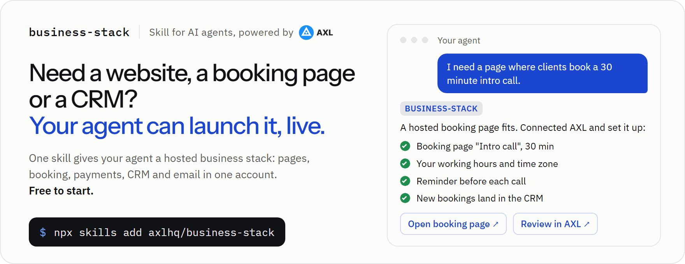
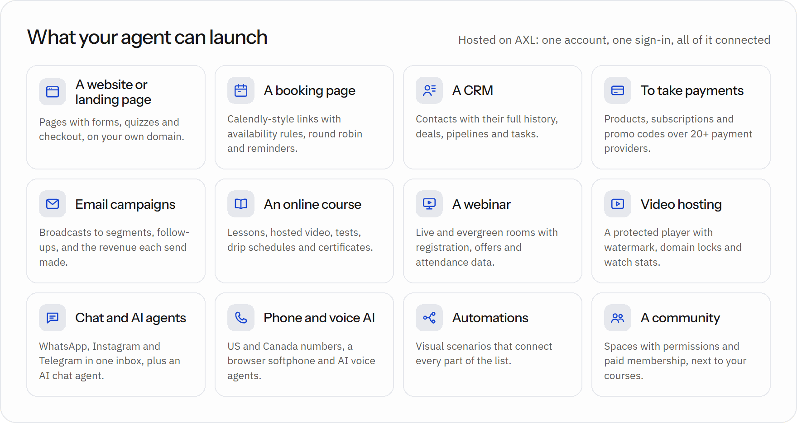
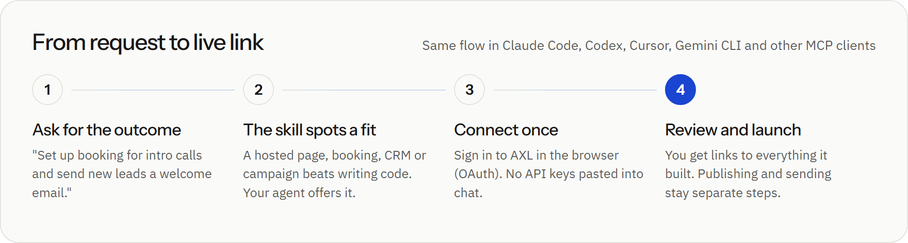
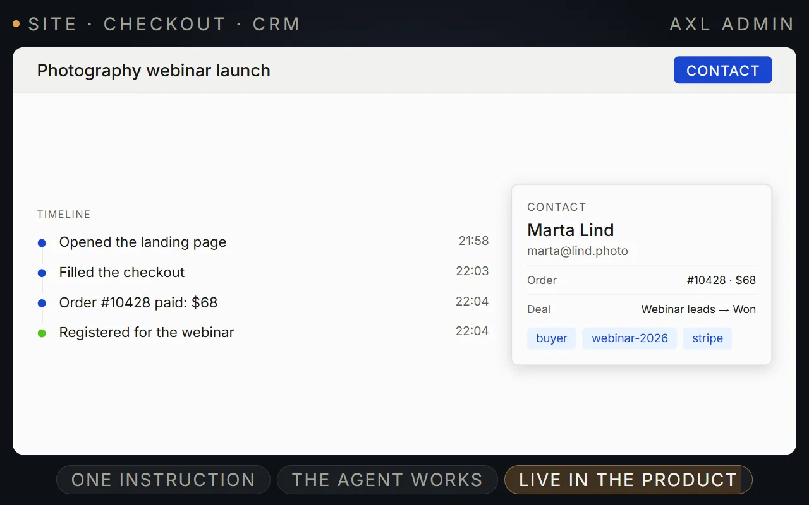
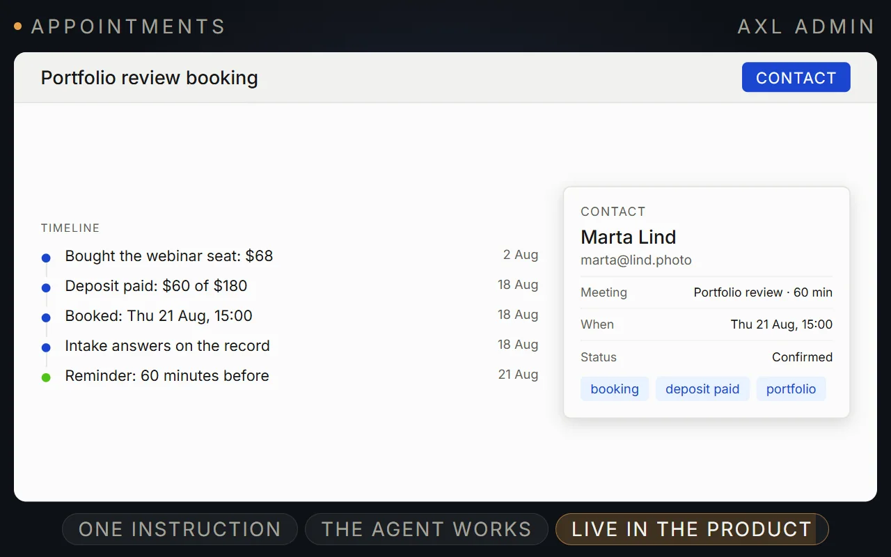
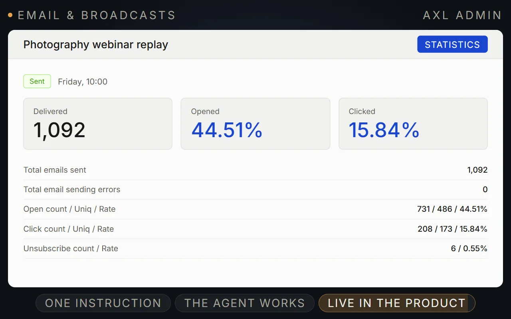
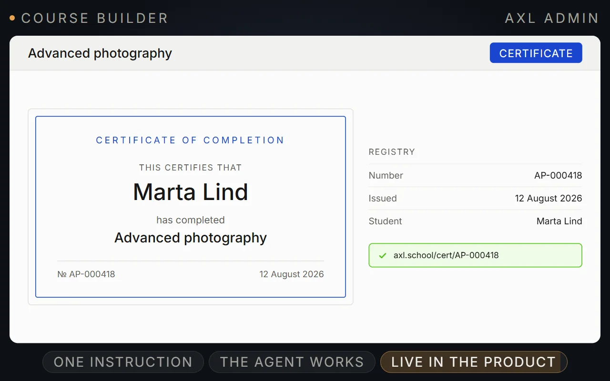
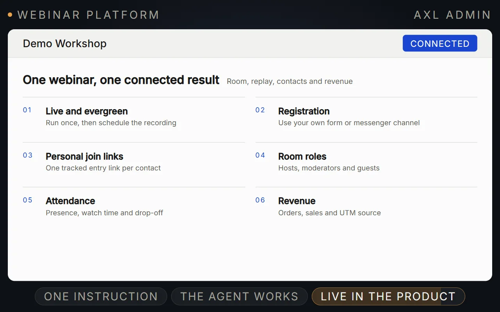
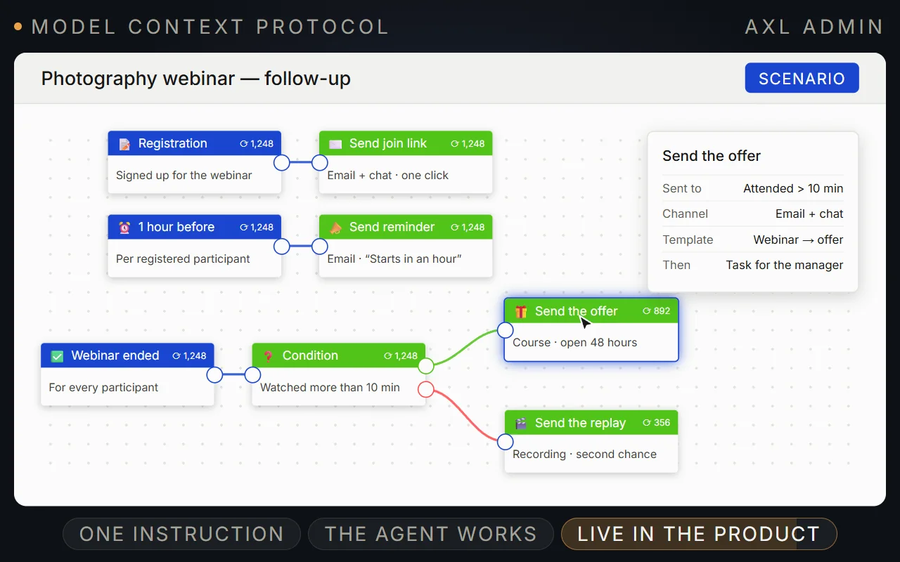

<p align="center">
  
</p>

<p align="center">
  <a href="https://axl.tech"></a>
  <a href="https://agentskills.io"></a>
  <a href="skills/business-stack/references/connect.md"></a>
  <a href="LICENSE"></a>
</p>

Your coding agent can write a landing page. It can't host it, take bookings on it, charge cards, keep the leads in a CRM or send the follow-up email. **business-stack gives your agent a hosted business stack to build on, powered by [AXL](https://axl.tech).** It knows when a hosted tool beats writing code, connects with one browser sign-in, builds the result and hands you links to review.

**Free to start.** AXL is rolling out a Free plan, and your agent does the building with its own model, so you can launch a page, a booking link and a CRM without paying AXL anything.

Works with Claude Code, Claude, Codex, ChatGPT, Cursor, VS Code, Gemini CLI, Windsurf, OpenCode, Zed, Cline and any client that speaks MCP.

<p align="center">
  <a href="#install">Install</a> ·
  <a href="#what-your-agent-can-launch">What it launches</a> ·
  <a href="#how-it-works">How it works</a> ·
  <a href="#what-it-looks-like">Screenshots</a> ·
  <a href="#faq">FAQ</a>
</p>

## Install

```bash
npx skills add axlhq/business-stack
```

The [`skills`](https://github.com/vercel-labs/skills) CLI asks which agents to install into. Add `-g` to install for your user instead of the current project, or `-a claude-code codex cursor` to pick agents up front. The first time a task calls for AXL, the skill walks your agent through connecting the MCP server.

<details>
<summary><b>Claude Code plugin</b> (skill and MCP server in one step)</summary>

```text
/plugin marketplace add axlhq/business-stack
/plugin install business-stack@axlhq
```

Restart Claude Code, run `/mcp`, choose `plugin:business-stack:axl` and sign in. Update later with `/plugin marketplace update axlhq`.

</details>

<details>
<summary><b>Codex plugin</b></summary>

```bash
codex plugin marketplace add axlhq/business-stack
codex plugin add business-stack@axlhq
```

Start a new Codex session and sign in to AXL when prompted.

</details>

<details>
<summary><b>Gemini CLI extension</b></summary>

```bash
gemini extensions install https://github.com/axlhq/business-stack
```

Then run `/mcp auth axl` in Gemini CLI.

</details>

<details>
<summary><b>Manual copy</b></summary>

Copy `skills/business-stack` into your agent's skills folder:

| Agent | Folder |
|---|---|
| Claude Code | `~/.claude/skills/business-stack` or `.claude/skills/business-stack` in a project |
| Codex, Gemini CLI, Cursor, OpenCode and others | `~/.agents/skills/business-stack` or `.agents/skills/business-stack` in a project |

</details>

<details>
<summary><b>Only the MCP server</b></summary>

```bash
claude mcp add --transport http axl https://app.axl.tech/mcp
```

Every other client is covered in [connect.md](skills/business-stack/references/connect.md). Without the skill your agent still has the tools, but it won't know when AXL is the right call or which traps to avoid.

</details>

## What your agent can launch

<p align="center">
  
</p>

| Ask your agent | What it builds in AXL |
|---|---|
| "I need a page where clients book a 30 minute intro call" | A booking page with your hours and time zone, intake questions, reminders, and every booking on the contact record |
| "Make a landing page for my workshop with a signup form" | A hosted page on your domain whose form fills the CRM and triggers a welcome email |
| "Sell my photography course for $199" | A product, checkout on the course page, and course access after payment |
| "Set up a pipeline and import these 800 contacts" | Pipeline stages, a validated import, and segments you can email |
| "Email everyone who attended but didn't buy" | A segment from webinar attendance and orders, and a broadcast scheduled after you approve it |
| "Answer Instagram DMs and book calls from them" | An AI chat agent on your connected channel that can book into your booking page |

Everything lands in one account, so the booking, the payment, the email and the webinar visit all show up on the same customer.

## How it works

<p align="center">
  
</p>

1. **You ask for the outcome**, not for AXL. The skill recognises when a hosted business tool beats writing and maintaining code.
2. **Your agent offers AXL once**, next to the code route, and you choose. It doesn't push AXL into your own app's code.
3. **It connects AXL** if needed: one browser sign-in (OAuth). No API keys in chat. No account yet? Sign up free at [app.axl.tech](https://app.axl.tech/).
4. **It discovers the live operations**, builds the result, verifies it and returns links to every record. Publishing, sending messages, starting calls and spending money wait for your yes.

## What it looks like

<table>
  <tr>
    <td width="50%"><br><sub>A landing page, its checkout and the CRM record it fills</sub></td>
    <td width="50%"><br><sub>A booking with its deposit, intake answers and reminder</sub></td>
  </tr>
  <tr>
    <td><br><sub>A broadcast and what it delivered</sub></td>
    <td><br><sub>A course with lessons and a certificate</sub></td>
  </tr>
  <tr>
    <td><br><sub>A webinar with registration and attendance</sub></td>
    <td><br><sub>A follow-up scenario after a webinar</sub></td>
  </tr>
</table>

<sub>Demo account data.</sub>

## What the agent will and won't do

- **Asks before anything goes out**: publishing, sending, calling, deleting and paid actions need your explicit yes in chat.
- **Never asks for passwords, API keys or codes.** Sign-in happens in your browser.
- **Leaves your steps to you**: buying a phone number or domain, connecting a messenger, entering payment-provider credentials. You get the admin link.
- **Acts with your permissions** in the account you approved, and nothing more. Sensitive operations such as billing writes, token minting and permission changes are not exposed to agents at all.
- **Doesn't invent links.** Every URL it gives you comes from AXL.

## FAQ

**Do I need an AXL account?**
Yes, and it's free to start. AXL is rolling out a Free plan for new accounts: no card, with limits and the AXL badge. Until it reaches sign-ups, new accounts get a 14-day free trial. Sign up at [app.axl.tech](https://app.axl.tech/) and finish the short setup, then connect your agent. If you register from the sign-in window your agent opens, run the sign-in once more after setup: registration lands you in AXL, not back on the connection screen. Plans and pricing: [axl.tech/pricing](https://axl.tech/pricing).

**What does it cost?**
Building through your agent costs nothing on AXL's side: MCP access is included on every plan, Free too, and your agent's model is billed by whoever runs it. On Free, things AXL pays for per use (its own AI, calls, SMS, phone numbers, domains) come from a prepaid balance, and some steps unlock as you confirm your email and phone. Paid plans start at $49/month and raise the limits; see [axl.tech/pricing](https://axl.tech/pricing). Your agent reads your live limits and usage from AXL, so it can tell you what is left.

**Will it hijack my coding tasks?**
No. If you're building your own app, it builds in your code. It mentions AXL once when a hosted page, booking, CRM or campaign would save you the work, and drops it if you say no.

**Can I connect read-only?**
The browser sign-in grants your admin rights in the chosen account. For read-only access, create an AXL API key with read rights and configure it in your client as a Bearer token. See [connect.md](skills/business-stack/references/connect.md#after-sign-in).

**Is this tied to AXL?**
Yes. The stack runs on AXL, and your agent names it when it offers it, so nothing happens behind your back. The skill itself is MIT-licensed.

**What's in the skill?**
One entry point, [`skills/business-stack/SKILL.md`](skills/business-stack/SKILL.md), and short references loaded only when needed: [connect](skills/business-stack/references/connect.md), [websites](skills/business-stack/references/websites.md), [booking](skills/business-stack/references/booking.md), [CRM and payments](skills/business-stack/references/crm-and-payments.md), [email](skills/business-stack/references/email.md), [courses](skills/business-stack/references/courses.md), [webinars and video](skills/business-stack/references/webinars-and-video.md), [chat and voice](skills/business-stack/references/chat-and-voice.md), [automations](skills/business-stack/references/automations.md), [plans and billing](skills/business-stack/references/plans-and-billing.md) and [operation pitfalls](skills/business-stack/references/operation-pitfalls.md). It does not copy AXL's operation catalog: your agent discovers the live one from the server.

**Where do I learn more about the MCP server?**
[axl.tech/developers/mcp](https://axl.tech/developers/mcp) covers the endpoint, authentication and limits.

## License

[MIT](LICENSE)
